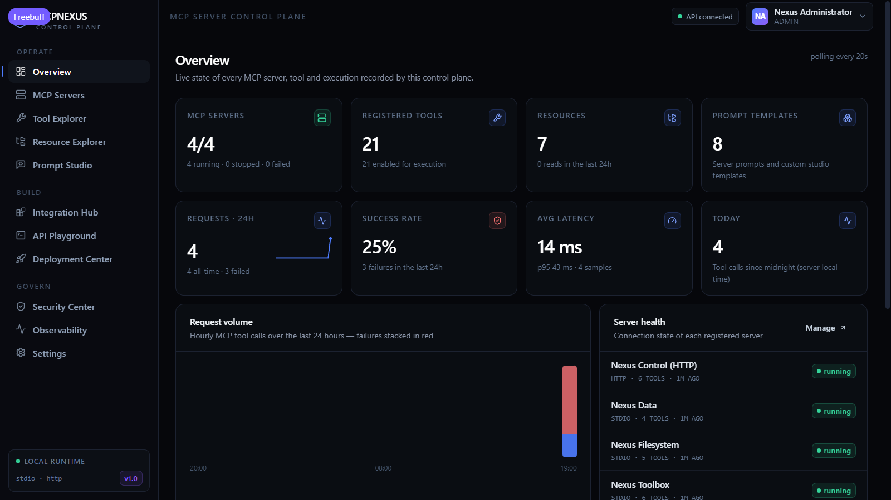
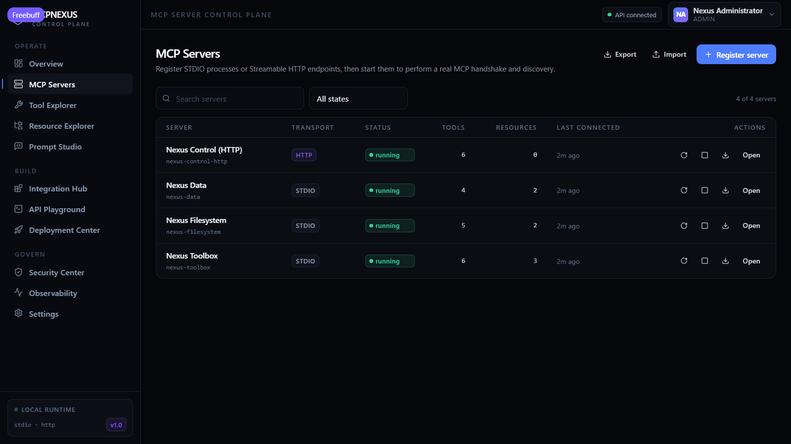
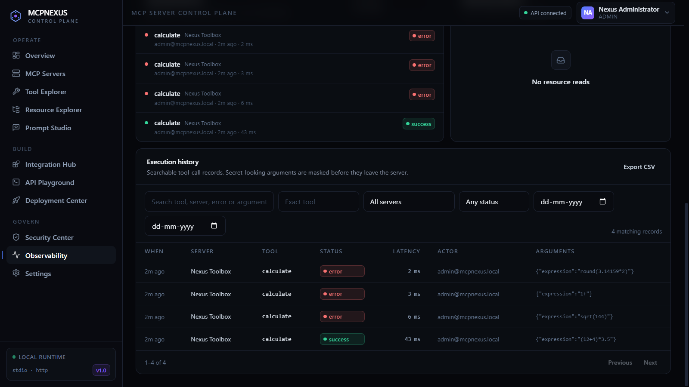
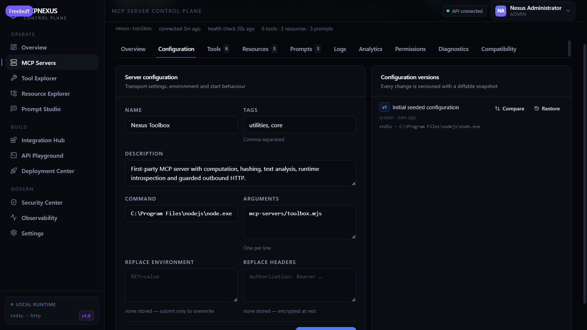
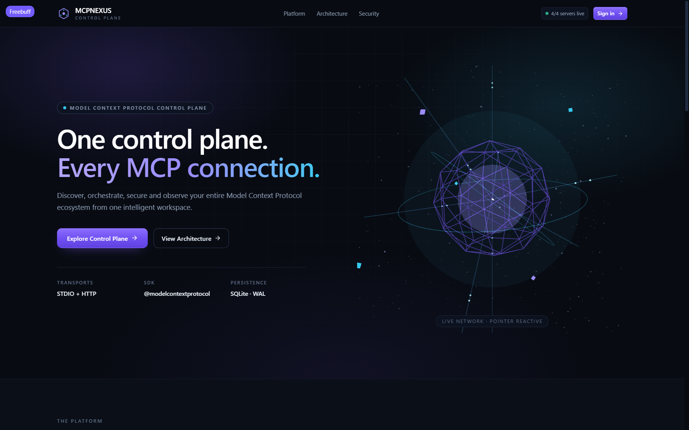
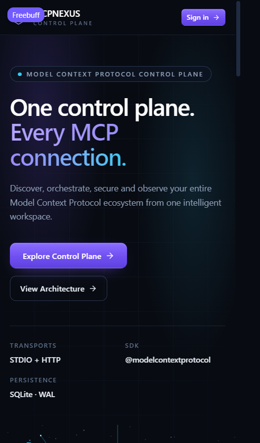
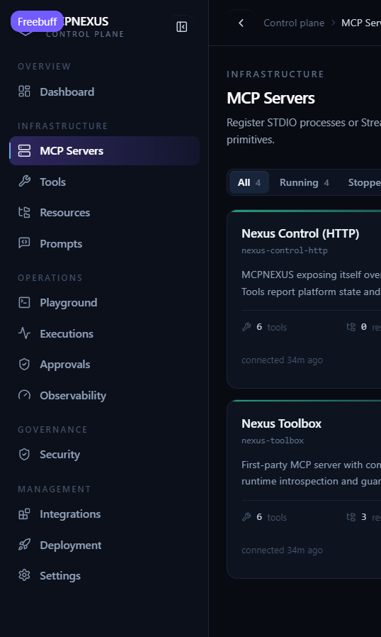
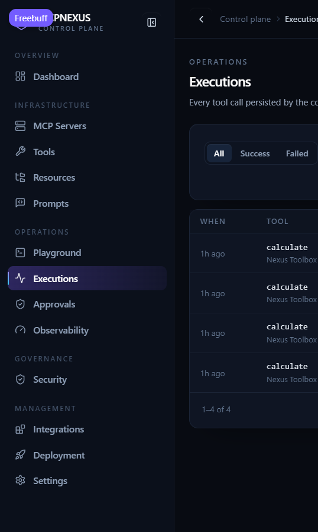
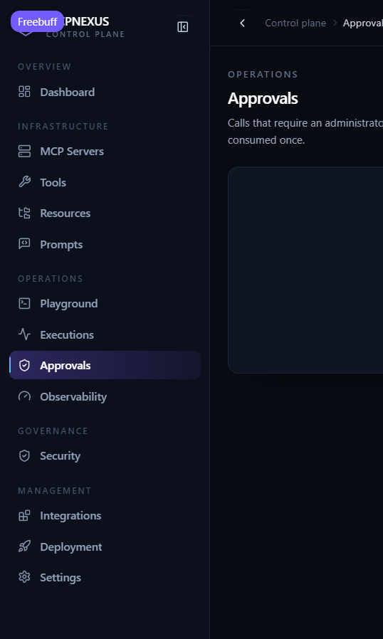
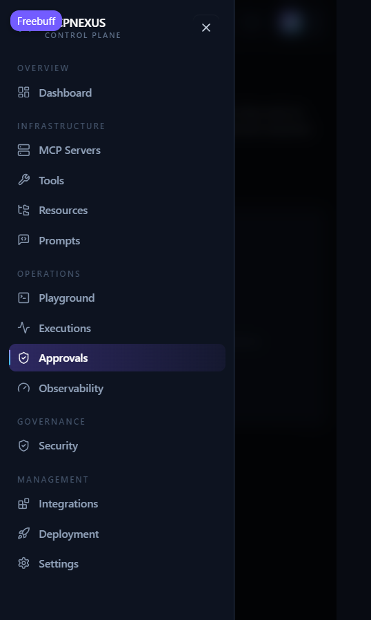

# MCPNEXUS

**The intelligent MCP server control plane.**
Connect. Orchestrate. Secure. Observe.

MCPNEXUS is a developer platform for operating [Model Context Protocol](https://modelcontextprotocol.io) servers.
It connects to real MCP servers over **STDIO** and **Streamable HTTP**, discovers their tools, resources and
prompts, executes genuine `tools/call` requests, and records every interaction in a persistent, queryable
control plane with authentication, RBAC, approval gates, audit trails and real metrics.

  

---

## Screenshots

| Overview | MCP Servers |
| --- | --- |
|  |  |

| Execution history | Configuration versions |
| --- | --- |
|  |  |

| Landing (hero + 3D) | Landing (mobile) |
| --- | --- |
|  |  |

| MCP Servers (new shell) | Executions (new) |
| --- | --- |
|  |  |

| Approvals | Mobile navigation |
| --- | --- |
|  |  |

## A note on the original backend

The workspace this project was built in contained **no pre-existing MCP server implementation, no frontend and
no Git history** — only an empty directory. Nothing was deleted or overwritten.

Instead of inventing a backend, MCPNEXUS is built directly on the **official
`@modelcontextprotocol/sdk` (v1.32.2)** — the same implementation that powers the reference
`modelcontextprotocol/servers` repository. Every server connection, capability negotiation, discovery call,
tool invocation, resource read and prompt expansion goes through the real SDK's client and server classes.
No mock MCP layer, no static fixtures, no simulated tool output exists anywhere in the codebase.

Three first-party MCP servers written against the SDK are bundled so the platform is useful immediately, and
the control plane also exposes **itself** as a Streamable HTTP MCP server.

---

## Feature set

### Server management
- Register, edit and delete MCP servers with STDIO or Streamable HTTP transports.
- Start / stop / restart with live status, connection state and last-error reporting.
- Automatic capability discovery (`tools/list`, `resources/list`, `resources/templates/list`, `prompts/list`).
- Captured stderr, protocol errors and lifecycle events in a bounded per-server log buffer.
- Auto-start on boot, tags, enable/disable, environment-specific configuration.
- Configuration **versioning** with snapshots and one-click restore.

### Tool explorer
- Schema-driven argument forms generated from each tool's live JSON input schema.
- Raw JSON mode for advanced payloads.
- Server-side validation before the call is sent (required fields, types, enums, bounds, patterns).
- Real execution with duration, content parts, structured content and error inspection.
- Per-tool enable/disable and approval controls.
- Persisted execution history per tool.

### Resource & prompt explorers
- Static resources and URI templates with MIME types.
- Real `resources/read` with text and binary handling.
- `resources/updated` notifications surfaced in the UI.
- Server prompts with argument validation and `prompts/get` message previews.
- Custom prompt templates with `{{variable}}` placeholders, categories and rendering.

### Security center
- Session-cookie authentication with scrypt password hashing.
- Three-role RBAC matrix (admin / operator / viewer) enforced server-side on every route.
- Permission policies with `global`, `role`, `user`, `server`, `tool` and `tag` scopes; deny wins.
- Approval gates for sensitive tools — non-admins park a call until an administrator decides.
- AES-256-GCM encryption for server env vars, HTTP headers and integration credentials.
- Secret masking everywhere (API responses and UI), constant-time password comparison.
- Audit trail of every mutating action plus auth, approval and denial events.
- Sliding-window rate limiting (240 req/min per session by default).
- Sandboxed filesystem MCP server that rejects path traversal.

### Observability
- Real request counts, success rate, average and percentile latency, per-tool usage, error distribution.
- Hourly time series (zero-filled) computed from persisted executions — no synthetic data.
- Uptime/health history from periodic JSON-RPC pings.
- Execution timeline with actor, duration and status.
- Resource access statistics.

### Differentiators
| Feature | Where |
| --- | --- |
| MCP compatibility inspector (capability matrix, schema validation, findings) | Server → Compatibility |
| Smart diagnostics with actionable suggestions | Server → Diagnostics |
| Execution timeline | Observability |
| Configuration versioning & restore | Server → Configuration |
| Permission policies & approval trail | Security Center |
| Developer API playground (real requests, real payloads) | API Playground |
| Self-hosted MCP-over-HTTP endpoint | `POST /mcp` + the "Nexus Control (HTTP)" server |

---

## Requirements

- **Node.js ≥ 22.5** (uses the built-in `node:sqlite` module). Verified on Node 24.16.
- npm 10+.
- No external database, container or cloud account is required.

## Quick start

```bash
npm install
npm run dev
```

- UI: <http://localhost:5317> (Vite dev server, proxies `/api` to the backend)
- API: <http://127.0.0.1:4317>

On first boot the platform creates the administrator account and writes a **random** password to
`data/initial-admin.txt` (mode `0600`):

```bash
cat data/initial-admin.txt   # email + generated password
```

There is no default password. For a scripted deployment, set `MCPNEXUS_ADMIN_EMAIL` and
`MCPNEXUS_ADMIN_PASSWORD` **before the first boot** — they are only applied when the users table is empty.
Sign in, change the password, then delete the file.

### Production

```bash
npm run build     # builds the SPA to dist/web and the server to dist/server
npm start         # serves API + SPA on http://127.0.0.1:4317
```

`PORT` is ignored when empty; use `MCPNEXUS_PORT` (see `.env.example`).

---

## Bundled MCP servers

| Server | Transport | What it proves |
| --- | --- | --- |
| **Nexus Toolbox** (`mcp-servers/toolbox.mjs`) | STDIO | Safe arithmetic, hashing, text stats, runtime introspection, guarded outbound HTTP |
| **Nexus Filesystem** (`mcp-servers/filesystem.mjs`) | STDIO | Sandboxed read/write/search with traversal protection, resource templates |
| **Nexus Data** (`mcp-servers/data.mjs`) | STDIO | Real SQLite database: schema introspection, read-only SQL, aggregations |
| **Nexus Control (HTTP)** | Streamable HTTP | MCPNEXUS exposing itself: list servers, proxy tool calls, read metrics |

All four auto-start on a fresh install, so the dashboard is populated by real discovery rather than seed data.

## Registering your own server

STDIO:

```json
{
  "name": "My Server",
  "transport": "stdio",
  "command": "node",
  "args": ["/abs/path/to/server.js"],
  "tags": ["local"],
  "env": "API_KEY=…"
}
```

Streamable HTTP:

```json
{
  "name": "Remote Server",
  "transport": "http",
  "url": "https://example.com/mcp",
  "headers": "Authorization: Bearer …"
}
```

Both are creatable from **MCP Servers → Register server** or `POST /api/servers`.

## Import and export

**MCP Servers → Export** downloads a portable bundle:

```json
{
  "schema": "mcpnexus.server-export",
  "version": 1,
  "exportedAt": "2026-11-14T19:00:00.000Z",
  "servers": [{ "name": "Nexus Toolbox", "transport": "stdio", "command": "node", "args": ["mcp-servers/toolbox.mjs"], "envKeys": ["API_TOKEN"] }]
}
```

Secret **values** are never exported — only key names, so a bundle is safe to commit or share. **Import**
validates the bundle, shows a per-entry plan (`create` / `overwrite` / `skip` / `invalid`) before applying,
and supports `conflict: "skip" | "overwrite" | "rename"` plus `dryRun: true` via
`POST /api/servers/import`. Re-enter credentials after importing.

---

## Configuration

Copy `.env.example` to `.env`. Key variables:

| Variable | Default | Purpose |
| --- | --- | --- |
| `MCPNEXUS_PORT` | `4317` | API + production SPA port |
| `HOST` | `127.0.0.1` | Bind address |
| `MCPNEXUS_DATA_DIR` | `./data` | SQLite database, master key, workspace |
| `MCPNEXUS_MASTER_KEY` | generated | 32-byte hex key for secret encryption |
| `MCPNEXUS_ADMIN_EMAIL` / `_PASSWORD` | admin@mcpnexus.local / *generated* | First-run admin (no default password) |
| `MCPNEXUS_SESSION_TTL_HOURS` | `168` | Session lifetime |
| `MCPNEXUS_COOKIE_SECURE` | `false` | Set `true` behind HTTPS |
| `MCPNEXUS_CONNECT_TIMEOUT_MS` | `20000` | MCP handshake timeout |
| `MCPNEXUS_TOOL_TIMEOUT_MS` | `60000` | Tool call timeout |
| `MCPNEXUS_RATE_LIMIT_PER_MINUTE` | `240` | API rate limit per session |

`data/master.key` is generated on first boot if `MCPNEXUS_MASTER_KEY` is absent. **Back it up** — encrypted
secrets cannot be recovered without it.

---

## Testing

```bash
npm test          # 28 integration tests against a throwaway data directory
npm run typecheck # tsc for server and web
npm run build     # production build
```

The suite exercises password hashing and AES-GCM round-trips, schema validation, unauthenticated access,
failed and successful login, server registration validation, a real STDIO `tools/call`, schema rejection,
persistence of executions, the full approval workflow (pending → approved → executed → file written),
viewer denial, resource reads, prompt expansion, real metrics/audit output, config export/import
(dry run, skip, rename, invalid entries), config diffing, execution search and CSV export, argument
masking, and the security headers.

## Project structure

```
mcp-servers/            First-party MCP servers (official SDK, .mjs)
src/server/
  app.ts                Express app, security headers, static SPA
  index.ts              Boot: migrations → seed → listen → auto-start
  auth.ts               Sessions, RBAC matrix, policy evaluation, audit
  crypto.ts             scrypt hashing, AES-256-GCM, masking
  db.ts                 node:sqlite bootstrap, schema, query helpers
  migrations.ts         Versioned migrations runner
  mcp/manager.ts        MCP client sessions, discovery, invocation, health
  mcp/control-server.ts Platform's own Streamable HTTP MCP server
  routes/               auth, servers, primitives, insights, integrations, platform
  metrics.ts            Aggregations from persisted executions
  diagnostics.ts        Diagnostic engine + schema auditing
  compat.ts             Compatibility inspector
  integrations.ts       Integration catalog and real provider checks
  seed.ts               Admin, bundled servers, policies, integrations, prompts
src/web/                React + Vite + Tailwind SPA
tests/                  Vitest + Supertest integration suite
docs/                   Architecture and API reference
```

## Security posture

- Local-first: binds to `127.0.0.1`, HTTP-only session cookies, `SameSite=Lax`.
- All mutation endpoints require authentication and a specific permission.
- Tool arguments are validated before an MCP call is sent; tool enablement is enforced server-side.
- Approval decisions are single-use and bound to the exact tool, server and arguments.
- Secrets are encrypted at rest, never returned by the API, and masked in the UI.
- Filesystem access is confined to `data/workspace`; `http_fetch` only allows http(s) URLs.
- No default administrator password: first boot generates one into a `0600` file, or you supply it via env.
- `/api` responses are `no-store`; production adds HSTS and a restrictive CSP; execution arguments are
  masked for secret-looking keys before they leave the server, including CSV exports.

Full threat model and the findings fixed in this pass: [docs/SECURITY.md](docs/SECURITY.md).

## Known limitations

- **Single-node.** Sessions, rate limits and MCP connections live in the process; there is no horizontal scaling.
- **No built-in TLS.** Run behind a reverse proxy and set `MCPNEXUS_COOKIE_SECURE=true`.
- **Client capabilities are intentionally minimal.** MCPNEXUS advertises no `sampling`, `roots` or `elicitation`
  support; servers that require them will not get those features (reported by the compatibility inspector).
- **No OAuth** for remote MCP servers — bearer headers are the supported mechanism.
- **Deployment Center is a readiness checker**, not a cloud deployer: it validates runtime, database,
  migrations, SDK version, server connectivity and build artifacts.
- **Integrations require your own credentials.** GitHub, REST API and Webhook stay `disconnected` until
  configured; they are never faked as connected.
- The bundled SQLite servers are demonstration data, not production datasets.

## Documentation

- [Architecture](docs/ARCHITECTURE.md)
- [API reference](docs/API.md)
- [Security model](docs/SECURITY.md)
- [Database design](docs/DATABASE.md)
- [Development guide](docs/DEVELOPMENT.md)
- [Testing](docs/TESTING.md)
- [Deployment](docs/DEPLOYMENT.md)
- [Release checklist](docs/RELEASE_CHECKLIST.md)

## License

MIT — see [LICENSE](LICENSE).
