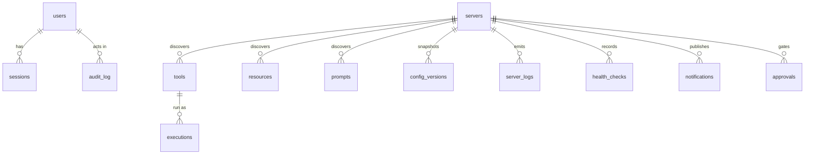

# Database design

MCPNEXUS stores all durable state in a single SQLite database accessed through
Node's built-in [`node:sqlite`](https://nodejs.org/api/sqlite.html) driver (Node
≥ 22.5). WAL mode, `foreign_keys = ON` and a 5s busy timeout are set on connect.

- Path: `MCPNEXUS_DATA_DIR/nexus.db` (default `./data/nexus.db`)
- Master key: `MCPNEXUS_DATA_DIR/master.key`
- Sandbox: `MCPNEXUS_WORKSPACE` (default `./data/workspace`)
- The analytics MCP server keeps its **own** SQLite file under `data/mcp-data/`.

## Entity overview



## Tables

| Table | Purpose | Notes |
|---|---|---|
| `users` | Accounts | `email` unique, `role` in (`admin`,`operator`,`viewer`), scrypt hash |
| `sessions` | Server-side sessions | Stores only `sha256(token)`; `expires_at` enforced on read |
| `servers` | MCP server registry | `transport` = `stdio` \| `http`; `env`/`headers` encrypted blobs; `status`, `last_error`, negotiated `capabilities`, `server_info`, `protocol_version` |
| `tools` | Discovered tools | `input_schema` JSON, `requires_approval`, `enabled`; unique per `(server_id, name)` |
| `resources` | Discovered resources | `uri`, `mime_type`, `is_template`; unique per `(server_id, uri)` |
| `prompts` | Discovered prompts | `arguments` JSON |
| `custom_prompts` | Prompt Studio templates | `{{variable}}` placeholders become required arguments |
| `executions` | Every tool call | `arguments`, `result`, `error`, `duration_ms`, `is_error`, `user_email`, `approval_id` |
| `resource_reads` | Resource access log | `bytes`, `duration_ms`, `status` |
| `approvals` | Approval gate | `pending` → `approved`/`rejected` → `consumed` |
| `policies` | Permission policies | scope ∈ global/role/user/server/tool/tag; effect ∈ allow/deny; `requires_approval` |
| `config_versions` | Immutable config snapshots | `(server_id, version)` monotonic, `created_by`, `note` |
| `integrations` | Integration catalog + state | `config` encrypted; `status`, `last_error` |
| `deployments` | Readiness runs | `checks` JSON array of check results |
| `health_checks` | Per-server ping history | `status`, `latency_ms`, `error` |
| `server_logs` | Captured server output | Bounded to the newest 500 rows per server |
| `notifications` | MCP notification log | `tools/list_changed`, `resources/list_changed`, `resources/updated` |
| `audit_log` | Security/audit trail | Append-only via API; actor, action, target, detail, IP |
| `settings` | Key/value platform settings | Includes the generated `mcp.http_token` |
| `schema_migrations` | Applied migration ids | Written by the runner |

## Indexes

`executions(created_at)`, `executions(server_id)`, `executions(tool_name)`,
`executions(status)`, `audit_log(created_at)`, `health_checks(server_id, checked_at)`,
`server_logs(server_id, created_at)`, `resource_reads(created_at)`,
`notifications(created_at)`. The baseline schema is created idempotently on boot;
`src/server/migrations.ts` records ordered, once-only upgrades.

## Retention

| Data | Retention |
|---|---|
| `server_logs` | Newest 500 rows per server (trimmed on insert) |
| `health_checks` | Newest 200 per server (trimmed by the health loop) |
| `sessions` | Deleted when expired on next use |
| `executions`, `audit_log`, `resource_reads` | Retained indefinitely (export via CSV) |

## Backup and restore

SQLite in WAL mode must be copied together with its sidecar files, or dumped:

```bash
# consistent online backup
node -e "const {DatabaseSync}=require('node:sqlite');const db=new DatabaseSync('data/nexus.db');db.exec(\"VACUUM INTO 'data/backup-nexus.db'\")"

# restore
# 1. stop the platform (SIGTERM) 2. replace data/nexus.db 3. start again
```

`VACUUM INTO` produces a single consistent file that excludes the `-wal`/`-shm`
sidecars. Keep `master.key` with the database backup — without it, encrypted
`env`, `headers` and integration config cannot be read. Losing the key is
recoverable only by re-entering those secrets.

## Query conventions

- All access goes through `all` / `get` / `run` in `src/server/db.ts`, always with
  bound parameters — no string interpolation of user input into SQL.
- Timestamps are ISO-8601 UTC strings, so lexical ordering equals chronological
  ordering and `substr(created_at, 1, 13)` gives an hourly bucket.
